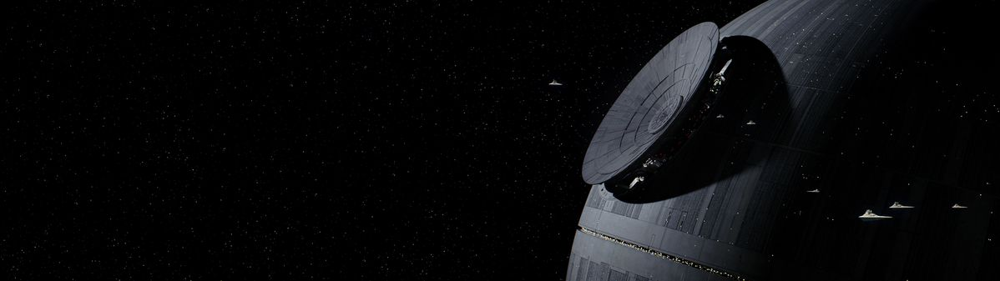

---
# Sup! I'm Daniel Donaire, nice to meet you 🤙

<h3 align="center">
Computer Science Student at CESAR School | Game Developer at FORJA Game Studio | Web & Application Development
</h3>

I'm a Computer Science student from Recife, Brazil, currently focused on game development, web development and application programming.

- Passionate about game development and interactive experiences
- Building games with Unity and Godot, while improving my skills in C#, C and Python
- Interested in building games, web apps and software development
- Open to collaborative projects and learning opportunities
- Gamer, Amateur sim racer and Star Wars fan

 
📫How to contact me:

## Main languages & tools:

  	        

### Other:
   
